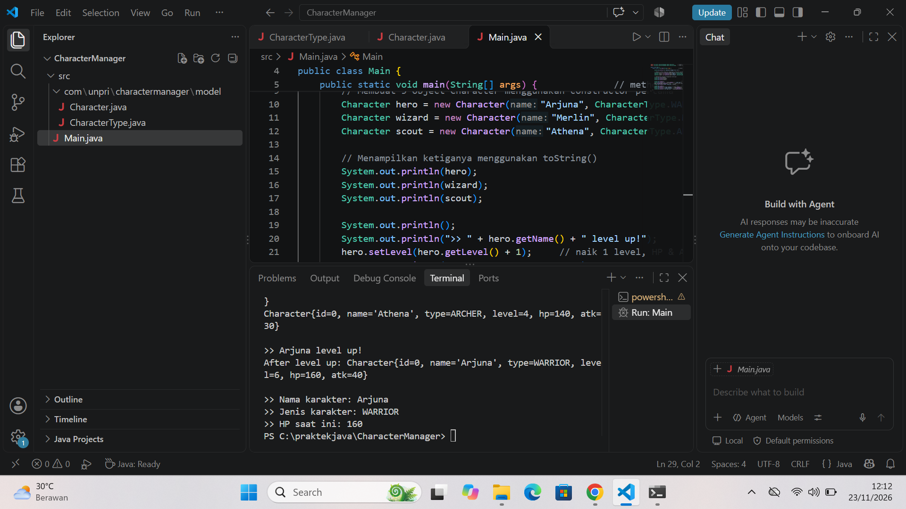

# Character Manager — TP3 (Java Visual SIH-6406)

## Deskripsi

Character Manager merupakan program berbasis Java yang dibuat untuk memenuhi Tugas Praktikum 3 (TP3) mata kuliah Java Visual SIH-6406.

Program ini mendemonstrasikan pengelolaan karakter menggunakan konsep Thread pada Java, termasuk proses menjalankan thread dan pemeriksaan status menggunakan method isAlive().

## Screenshot Output Terminal


Berikut merupakan dokumentasi hasil eksekusi program Java melalui terminal VS Code, termasuk hasil pemeriksaan method isAlive().


## Struktur Folder Project
```text
CharacterManager/
│
├── src/
│   │
│   ├── com/
│   │   └── unpri/
│   │       └── charactermanager/
│   │           └── model/
│   │               ├── Character.java
│   │               └── CharacterType.java
│   │
│   └── Main.java
│
└── README.md
```

## Identitas Mahasiswa

Nama Lengkap: Juni Swanto Halawa

NIM: 253303621300

Link Google Docs Bagian D: https://docs.google.com/document/d/1uvEvp6zHutEek7MUBzddivKPSoquK2Wr/edit?usp=drive_link&ouid=100111449079893387936&rtpof=true&sd=true